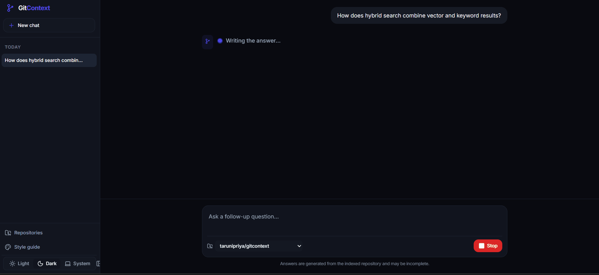
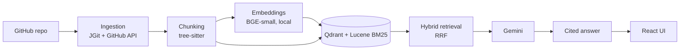

# GitContext

[](https://github.com/tarunipriya/gitcontext/actions/workflows/ci.yml)


[](LICENSE)

Ask questions about any GitHub repository — code, docs, commits and pull requests — and get answers that cite the exact lines.



## Features

- **AST chunking with tree-sitter**: Parses syntax trees across multiple programming languages to chunk code along function, class, and method boundaries.
- **Hybrid BM25 + vector retrieval with RRF**: Merges dense vector embeddings (Qdrant) and sparse keyword scores (Apache Lucene) via Reciprocal Rank Fusion.
- **Cited answers with Gemini**: Grounded answer generation using Google Gemini with strict attribution guidelines and validated bracketed citations (`[n]`).
- **Git history and PRs as sources**: Ingests commits, diffs, pull request discussions, and incident-labeled issues alongside source code and documentation.
- **Incremental re-indexing**: Computes deterministic SHA-256 chunk hashes to reuse existing embeddings on repo updates, reducing re-indexing from minutes to seconds.
- **Claude-style web UI**: Modern conversational interface with collapsible sidebar, fast typewriter reveal, slide-over source code inspection panel, and dark/light themes.
- **Evaluation suite**: Built-in benchmark runners measuring Hit@K, Recall@K, precision, MRR, fact coverage, refusal accuracy, groundedness, and latencies.
- **Docker one-command setup**: Complete multi-container orchestration packaging Qdrant, the Java 25 backend, and the React frontend.

## Quick Start

1. **Configure environment**:
   Copy `.env.example` to `.env` and configure your API keys:
   ```bash
   cp .env.example .env
   ```
   Set `LLM_API_KEY` (Gemini API key for answer generation) and optionally `GITHUB_TOKEN` (for pull request and issue ingestion).

2. **Launch with Docker**:
   ```bash
   docker compose --profile app up --build
   ```

3. **Open the applications**:
   - **Web UI:** [http://localhost:5173](http://localhost:5173)
   - **Interactive API Docs (Swagger UI):** [http://localhost:8081/swagger-ui.html](http://localhost:8081/swagger-ui.html)

## Architecture



For detailed architecture diagrams, incremental re-indexing mechanics, and reranking trade-offs, see the [Architecture Documentation](docs/architecture.md).

## Results

Measured with the evaluation suite in `eval/` on two repositories: this repository and the held-out [`spring-projects/spring-petclinic`](https://github.com/spring-projects/spring-petclinic). Datasets were written before running and not tuned afterwards.

**Headline (default configuration: hybrid BM25 + vector, equal-weight RRF, no reranker):** 73–77% Recall@5 across both repositories at under 60 ms p50 retrieval latency; 91% answer fact coverage with 92.9% of answers citing an expected source.

### Retrieval (k = 5)

| Variant | gitcontext Recall@5 | gitcontext p50 | petclinic Recall@5 | petclinic p50 |
|---|---|---|---|---|
| Vector (BGE-small) | 0.766 | 27 ms | 0.613 | 25 ms |
| Keyword (Lucene BM25) | 0.531 | 13 ms | 0.649 | 13 ms |
| **Hybrid RRF (default)** | **0.766** | **57 ms** | **0.732** | **46 ms** |
| Hybrid RRF, keyword weight 0.5 | 0.797 | 79 ms | 0.685 | 38 ms |
| Hybrid + cross-encoder rerank | 0.813 | 4221 ms | 0.613 | 3010 ms |

gitcontext: 32 answerable questions at commit `9fef021`; petclinic: 28 answerable questions at commit `500158f`. Questions cover code, docs, configuration and Git history (pull requests and commits).

**What the numbers show**
- **Hybrid is the robust choice.** Vector search is stronger on this repository, BM25 is stronger on petclinic (descriptive class names match question words), and hybrid matches or beats the best single retriever on both.
- **A tuned fusion weight did not generalize.** Lowering the keyword weight to 0.5 raised gitcontext Recall@5 from 0.766 to 0.797 but lowered petclinic from 0.732 to 0.685, so the default stays at 1.0.
- **The reranker is off by default.** `ms-marco-MiniLM-L-6-v2` is trained on web search, not code: it hurt petclinic (0.613 vs 0.732) and costs 3–4 s per query on CPU.

### Answer quality (gitcontext, 31 of 35 questions)

Answer model `gemini-3.5-flash`, graded by a separate judge model `gemini-3.5-flash-lite` at temperature 0, commit `863d682`.

| Metric | Value |
|---|---|
| Mean fact coverage | 0.910 |
| Fully correct answers | 0.875 (21 of 24 graded) |
| Answers citing an expected source | 0.929 (26 of 28 answerable) |
| Correct refusals on unanswerable questions | 1.000 (3 of 3) |
| False refusals on answerable questions | 0.143 (4 of 28) |
| Groundedness (judge) | 1.000 |
| End-to-end latency | p50 4.3 s, p95 11.7 s |

4 of the original 35 cases (gc-005 to gc-008) cited a commit whose diff contained evaluation data (leakage fixed in #34) and are excluded; the full run reported 0.923 fact coverage. Incomplete answers occur on exactly the questions where hybrid retrieval missed the source, and most false refusals are Git-history questions, so answer quality is bounded by retrieval quality. Groundedness of 1.000 means the judge found no obvious unsupported claims; a small judge from the same model family can be lenient, so it is not proof of zero hallucination.

### Data leakage check

Evaluation files are excluded from repository file ingestion and, since #34, from commit diffs. The leak was found through the web UI when an answer cited a commit containing evaluation data. Affected retrieval benchmarks were re-run on a clean index, and affected answer quality cases were excluded from the reported metrics.

### Reproduce

Datasets: [`eval/datasets/`](eval/datasets/). Full reports with per-question results: [`eval/results/`](eval/results/) — `gitcontext-20261026-032354.md`, `spring-petclinic-20261021-163602.md`, `answers-gitcontext-20261023-153022.md`. Evaluation commands and options are detailed in the [Evaluation Guide](docs/evaluation.md).

## Tech Stack

| Layer | Technologies |
|---|---|
| **Backend** | Java 25, Spring Boot 4, JGit, Spring WebMvc, SpringDoc OpenAPI |
| **Retrieval** | Qdrant (vector store), Apache Lucene 10 (BM25 sparse keyword), Reciprocal Rank Fusion (RRF), ONNX Runtime |
| **AI / Embeddings** | Google Gemini (3.5 Flash / 3.8 Flash), BGE-small-en-v1.5 (local ONNX embeddings) |
| **Frontend** | React 18, TypeScript strict, Vite, Tailwind CSS v4, shadcn/ui primitives |
| **Infrastructure** | Docker, Docker Compose, Nginx (unprivileged) |
| **Testing & CI** | JUnit 5, Mockito, AssertJ, Vitest, React Testing Library, GitHub Actions |

## Project Structure

```text
gitcontext/
├── backend/          # Java 25 & Spring Boot REST API, ingestion, chunking, retrieval
├── frontend/         # React 18 + Vite + Tailwind v4 conversational web UI
├── eval/             # Benchmark datasets, evaluation runners, and experiment results
├── docs/             # Architecture, development guides, and demo assets
├── docker-compose.yml# Multi-container orchestration (backend, frontend, Qdrant)
└── pom.xml           # Root build definition
```

## Documentation

- [Architecture & Design](docs/architecture.md): In-depth guide to AST chunking, incremental re-indexing, reranking, and grounded answer generation.
- [Development & Deployment](docs/development.md): Local environment setup, Docker Compose configuration, and Web UI development.
- [Evaluation Guide](docs/evaluation.md): Commands and procedures for running retrieval benchmarks and LLM answer-quality evaluation.
